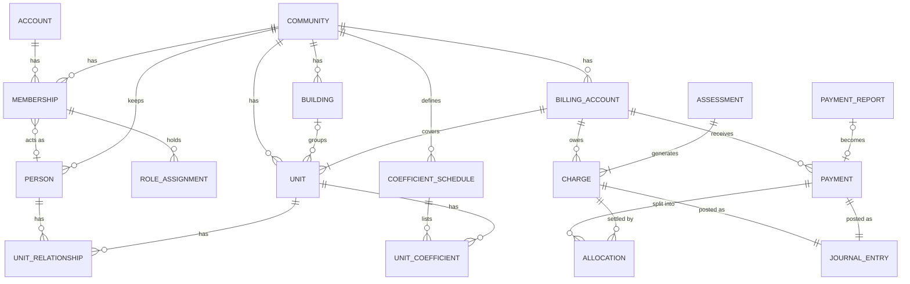

# Domain model

Status: **draft for review** (Phase 0). Reviewed together with
[`docs/accounting/`](../accounting/README.md), as the roadmap requires: the
billing model below is the subledger of the general ledger, not a separate
receivables system.

The demo community in [`database/seed/demo-community.json`](../../database/seed/demo-community.json)
(Edificio Los Robles) is used as the running example.

## 1. Decisions that shape everything else

1. **The community is the tenant.** Every business record belongs to exactly
   one community, except the platform account. No query, report or cache may
   combine records from two communities.
2. **Account, person and membership are three different things.**
   - An **account** is a login: one per human, platform-wide.
   - A **person** is a community's own record of a natural or legal person
     (owner, tenant, resident, supplier contact). It exists whether or not
     anyone ever logs in, and is never shared between communities.
   - A **membership** links an account to a community, and optionally to the
     person record that represents it there.

   The same human in two communities has one account, two memberships and two
   person records. Community A's administrators never see community B's
   record of that person.
3. **Receivables are kept per billing account, not per person.** A billing
   account normally covers one unit (or an apartment together with its
   parking space and storage room). Under Ley 675 de 2001, art. 29, an
   owner's debt follows the unit to the next owner, and owner and tenant are
   jointly liable. So the balance belongs to the unit, and each charge
   records who the responsible party was when it was issued.
4. **Everything financial is append-only.** Charges, payments, allocations and
   journal entries are never edited or deleted once posted. Corrections are
   new records that reverse or adjust (see accounting rules).
5. **Relationships are effective-dated.** Ownership, occupancy, roles and
   coefficients have `valid_from` / `valid_to`, so history ("who owned 307 in
   March?") is a query, not an archaeology project.

## 2. Overview

Modules (backend packages, see roadmap §5) and the entities they own:

| Module           | Entities                                                                 |
| ---------------- | ------------------------------------------------------------------------ |
| `identity`       | Account, Credential, Session/Token                                       |
| `communities`    | Community, Membership, RoleAssignment                                    |
| `properties`     | Building, Unit, CoefficientSchedule, UnitCoefficient                     |
| `residents`      | Person, UnitRelationship                                                 |
| `billing`        | BillingAccount, Assessment, Charge, Payment, PaymentReport, Allocation   |
| `accounting`     | LedgerAccount, FiscalYear, Period, JournalEntry, JournalLine, VoucherSequence |
| `payments`       | (Phase 5) PaymentIntent, ProviderEvent                                   |
| `communications` | Post, Board, Conversation, Message (Phase 3)                             |
| `audit`          | AuditEvent                                                               |

## 3. Identity and membership

### Account (`identity`)

| Field          | Notes                                                        |
| -------------- | ------------------------------------------------------------ |
| id             | UUID                                                         |
| email          | Unique, verified before the account can join a community     |
| display_name   |                                                              |
| locale         | `es-CO` default, `en`                                        |
| status         | `pending_verification`, `active`, `locked`, `closed`         |
| credentials    | Password hash (Argon2id/bcrypt via Spring Security); later external identities (Google) |

An account holds no community data. Closing an account ends its memberships
but keeps the person records, which belong to the communities.

### Membership (`communities`)

| Field        | Notes                                                              |
| ------------ | ------------------------------------------------------------------ |
| account_id   |                                                                    |
| community_id |                                                                    |
| person_id    | Optional: the community's person record for this account           |
| status       | `invited`, `active`, `suspended`, `ended`                          |
| invited_by, invited_at, joined_at, ended_at |                                     |

At most one non-ended membership per (account, community). Joining is by
invitation: an administrator invites an email, optionally pre-linked to a
person record; the invitee registers or signs in and accepts.

### Roles (`communities`)

Permissions come from two sources:

**Assigned roles** (RoleAssignment on a membership, effective-dated):

| Role                 | Spanish                       | Typical rights                                         |
| -------------------- | ----------------------------- | ------------------------------------------------------ |
| `administrator`      | Administrador(a)              | Everything operational; legal representative           |
| `accountant`         | Contador(a)                   | Accounting and billing; posts and reverses entries     |
| `treasurer`          | Tesorero(a)                   | Confirms payment reports, records payments             |
| `auditor`            | Revisor(a) fiscal             | Read everything, write nothing                         |
| `council_member`     | Miembro del consejo           | Privileged information, approves posts                 |
| `moderator`          | Moderador(a) / comité de convivencia | Moderates boards                                |
| `staff`              | Personal (portería, etc.)     | Limited operational access (later)                     |

**Derived roles**, computed from the person's current unit relationships:
`owner`, `resident`, `tenant`. These grant access to their own units,
statements and community content, without anyone assigning them.

Visibility tiers inherited from legacy ProHo (see `docs/legacy-salvage.md`):
**public**, **community** (any active member), **privileged** (council,
administration, accountant, auditor).

## 4. Property structure (`properties`)

### Community

| Field           | Notes                                                        |
| --------------- | ------------------------------------------------------------ |
| id, key         | `key` is a URL-safe slug, unique platform-wide (`los-robles`) |
| name, legal_name |                                                             |
| tax_id          | NIT                                                          |
| kind            | `residential` (MVP), `mixed`, `commercial`; later `club`, … |
| country, currency, timezone | `CO`, `COP`, `America/Bogota`                    |
| address         |                                                              |

### Building

Optional grouping: *torre*, *bloque*, *interior*. Communities with a single
building may have none.

### Unit (*unidad privada*)

| Field         | Notes                                                       |
| ------------- | ----------------------------------------------------------- |
| number        | Unique within community (and building, if any): `509`, `T2-1104` |
| kind          | `apartment`, `house`, `commercial`, `office`, `parking`, `storage` |
| building_id, floor | Optional                                               |
| area_m2       | Private area, as in the deed                                |
| registry_id   | *Matrícula inmobiliaria*, optional                          |

Parking spaces and storage rooms are units when they have their own deed and
coefficient. When they are *bienes comunes de uso exclusivo* they are not
units and carry no coefficient.

### Coefficients (*coeficientes de copropiedad*)

A **coefficient schedule** is a named, effective-dated set of coefficients:

- `general`: required, one entry per unit; defined by the *reglamento de
  propiedad horizontal*.
- Additional schedules for sector or module expenses (Ley 675, art. 29,
  mixed-use communities): e.g. only the commercial units share the
  commercial-area costs.

| Field       | Notes                                                       |
| ----------- | ----------------------------------------------------------- |
| schedule    | `general`, or a named sector schedule                       |
| unit_id     |                                                             |
| value       | Percentage with up to 6 decimals (`14.400000`)              |
| valid_from, valid_to | A reform of the reglamento creates a new version   |

Assessments use the schedule version in force on their issue date.

## 5. People and relationships (`residents`)

### Person

| Field          | Notes                                                     |
| -------------- | --------------------------------------------------------- |
| community_id   | A person record belongs to one community                  |
| kind           | `natural`, `legal` (owners can be companies)              |
| given_name, surname / legal_name |                                         |
| id_type, id_number | `CC`, `CE`, `NIT`, `PA`, `TI`; unique per community when present |
| emails, phones | Private by default                                        |
| privacy        | Per-field visibility chosen by the person when they have an account |

### UnitRelationship

| Field        | Notes                                                       |
| ------------ | ----------------------------------------------------------- |
| unit_id, person_id |                                                       |
| role         | `owner`, `tenant`, `resident`, `household_member`, `representative` |
| share        | Ownership share for co-owners (percentage); owners only     |
| valid_from, valid_to |                                                     |

One person can hold several roles on the same unit (Esteban is owner and
resident of 105). A unit can be owned by someone who does not live there
(Hernán, 212) and lived in by someone who owns nothing (Claudia, 212).

## 6. Billing (`billing`)

### BillingAccount (*cuenta de cobro por unidad*)

| Field              | Notes                                                   |
| ------------------ | ------------------------------------------------------- |
| community_id       |                                                         |
| units              | One or more units; each unit in exactly one open billing account |
| responsible_party  | Effective-dated person: who statements are addressed to and charges are issued against. Default: the owner (or first co-owner) |
| code               | Human-readable, usually the main unit number (`509`)    |

The billing account is the subledger key for receivables in the general
ledger (see accounting rules).

### Assessment (*cuota*)

The decision to charge something, before it becomes per-account charges.

| Field        | Notes                                                       |
| ------------ | ----------------------------------------------------------- |
| kind         | `ordinary`, `extraordinary`, `fine`, `interest`, `other`    |
| concept      | Maps to the income/fund account through posting rules      |
| total        | For coefficient allocation; or `amount_per_unit` for fixed fees |
| allocation   | `coefficient` (with schedule), `fixed_per_unit`, `fixed_per_kind`, `manual` |
| issue_date, due_date |                                                     |
| installments | Extraordinary assessments may be split into several due dates |
| approval     | Reference to the assembly or council act, required for extraordinary |
| status       | `draft`, `issued`, `cancelled` (cancel = reverse every charge) |

Allocation by coefficient splits the total with the **largest-remainder
method** at the community's rounding unit (1 peso by default; some
communities round to 100), so the charges always add up exactly to the total.

### Charge (*cargo*)

One line owed by one billing account: assessment, concept, amount, issue and
due dates, responsible party at issue time, and the journal entry that posted
it. Its open balance is `amount − Σ allocations`.

### Payment (*pago / recaudo*)

| Field          | Notes                                                    |
| -------------- | -------------------------------------------------------- |
| billing_account_id | Optional: an unidentified bank deposit has none yet  |
| payer          | Free text and/or person: whoever actually paid           |
| amount, date, method | `cash`, `bank_transfer`, `deposit`, `card`, `online` (Phase 5) |
| reference      | Bank or receipt reference; unique per (method, reference) to catch duplicates |
| receipt_number | Gapless per community (*recibo de caja*)                 |
| status         | `posted`, `reversed`                                     |

### PaymentReport (*reportar pago*)

Submitted by a resident: billing account, amount, date, method, reference,
attachment. States: `submitted` → `confirmed` (creates a Payment) or
`rejected` (with reason). Never touches the ledger by itself.

### Allocation (*aplicación de pago*)

Links part of a payment to part of a charge. Default order, per Código Civil
art. 1653: interest first, then oldest charges first; the accountant may
configure otherwise. Any unallocated remainder is a credit balance (*saldo a
favor*) on the billing account, applied automatically to the next charges.

## 7. Communications (Phase 3, outline)

Posts follow the publishing workflow in roadmap §3.5: `state`
(`draft`, `pending_approval`, `scheduled`, `published`, `withdrawn`) and
`audience` (`public`, `community`, `privileged`) are separate fields. Boards,
conversations and messages are detailed when Phase 3 starts.

## 8. Cross-cutting conventions

- **Identifiers:** UUIDv7 for every entity. Human-facing numbers (receipts,
  vouchers) come from gapless per-community sequences.
- **Money:** `BigDecimal` / `numeric(19,2)` with the community currency. No
  floating point anywhere, including clients.
- **Dates:** accounting and due dates are local dates in the community time
  zone; timestamps are UTC instants.
- **Audit:** every command that changes state writes an AuditEvent (actor
  account, membership, community, entity, action, before/after summary, time,
  request id) in the same transaction.
- **Soft vs hard deletion:** financial records are never deleted. Personal
  data can be anonymized on request where law allows (Ley 1581 de 2012,
  habeas data), keeping the financial history consistent.

## 9. Invariants

These must hold at all times and get automated tests in the backend:

1. Every record except Account belongs to exactly one community, and every
   reference between records stays inside that community.
2. At most one non-ended membership per (account, community).
3. Each unit has exactly one `general` coefficient in force; the
   `general` schedule in force adds up to 100 within ±0.000001 × number of units.
4. Each unit belongs to exactly one open billing account, and each billing
   account has exactly one responsible party in force.
5. Co-owner shares of a unit in force add up to 100.
6. An issued assessment's charges add up exactly to its total.
7. Σ allocations of a payment ≤ payment amount; Σ allocations of a charge ≤
   charge amount; allocations never cross communities or billing accounts.
8. The receivables balance of every billing account equals the sum of its
   subledger lines in the general ledger, and the sum over billing accounts
   equals the receivables control accounts.
9. Posted charges, payments, allocations and journal entries are immutable.
10. A payment report creates at most one payment, and only on confirmation.
11. Receipt and voucher numbers are unique and gapless per community and type.

## 10. Open questions for review

1. **Billing account grouping:** is "one billing account per apartment,
   including its parking and storage units" the right default for the pilot
   community?
2. **Responsible party default:** owner, or whoever the administrator
   designates per unit (common when tenants pay directly)?
3. **Fines (*sanciones*):** model now as an assessment kind (as above), or
   leave for after the MVP?
4. **Person identity documents:** required for owners in the MVP (needed for
   certificates and *paz y salvo*), or optional?
